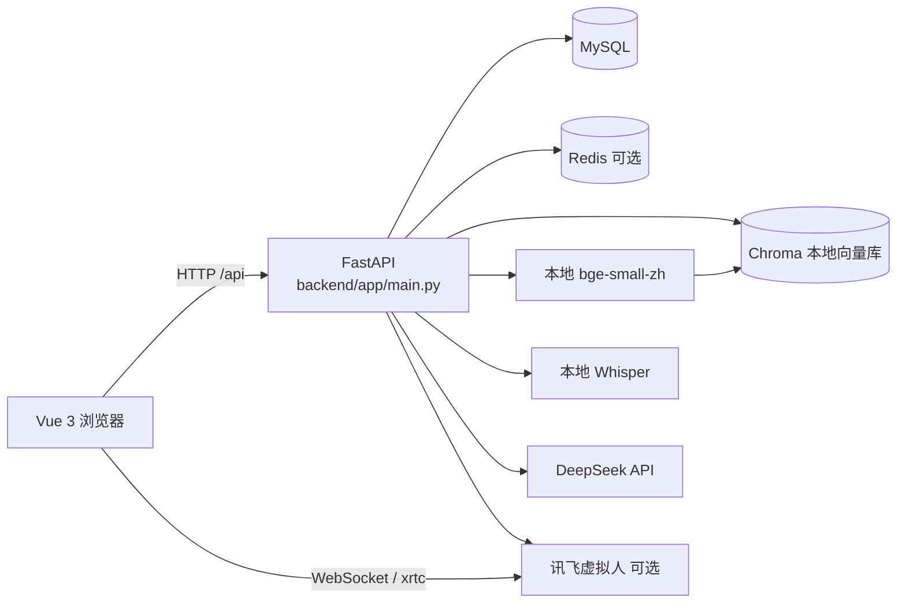

# AI 智能面试模拟与成长指导系统

面向求职者的模拟面试与能力提升工具，也提供企业端查看面试记录。文字、语音、视频面试走同一套评估流程，知识库检索和大模型报告在服务端完成。


## 使用流程

1. 打开前端，注册一个个人账号并登录。
2. 在「开始面试」里选择岗位、难度和文字模式，进入对话页。
3. 回答问题后，页面以流式方式显示下一问；结束后生成评估报告。
4. 在「成长轨迹」根据历史报告生成提升建议。
5. 在「简历」上传简历，查看解析与优化建议，并导出 PDF。
6. 在「知识库」上传资料，之后的提问会带上检索片段。
7. 用企业账号登录后，可在企业页查看用户面试记录。虚拟人面试官需要另行配置讯飞参数，不配置时其余功能仍可使用。

## 核心功能

- 按岗位进行文字、语音、视频模拟面试，并生成评估报告
- 简历解析、优化与 PDF 导出
- 知识库上传、分块、向量检索，以及基于检索结果的提问
- 历史成绩、成长曲线与提升建议
- 企业端查看面试记录、重置用户密码
- 可选的讯飞虚拟人面试官

大模型使用 DeepSeek。知识库向量使用本地 `bge-small-zh-v1.5`，因为 DeepSeek 不提供 Embedding 接口。语音转写使用本地 Whisper。

## 系统架构

本项目是 Web 软件，没有开发板、传感器或串口设备。数据在浏览器、FastAPI、MySQL 和可选的外部服务之间流动。



请求从 `frontend/src` 进入 `backend/app/routers`，由 `services` 调用模型和检索，`crud` 读写 MySQL。

## 运行前请先看

⚠️ **本项目不连接实体硬件。** 没有 MySQL、DeepSeek API Key，或本地向量模型目录时，直接运行会报错，或出现无法面试、无法检索、报告为空。请重点阅读 `backend/app/services`、`backend/app/routers` 和 `backend/app/config` 里的调用关系。虚拟人、Redis、语音和视频都是可选能力，缺配置时对应功能不可用，不应据此判断整套代码无法阅读。

## 依赖清单

没有需要购买或接线的硬件。运行依赖下面这些软件和账号。

| 名称 | 作用 | 是否必须 |
| --- | --- | --- |
| Python 3.10 或 3.11 | 后端运行时 | 必须 |
| Node.js 22.12+ | 前端开发与构建 | 必须 |
| MySQL 8 | 用户、简历、面试记录、知识库元数据 | 必须，需事先建库 |
| Redis | 登录令牌缓存 | 可选，失败时回退数据库 |
| DeepSeek API Key | 出题、评估、报告、简历、视频画面 | 面试与报告必须 |
| `bge-small-zh-v1.5` | 知识库向量，512 维 | 语义检索必须 |
| Whisper 权重 | 语音转写，首次使用自动下载 | 仅语音/视频转写 |
| FFmpeg（含 ffprobe） | 语音读取、视频音频提取与抽帧 | 仅语音、视频模式 |
| `bge-reranker-base` | 检索重排序，首次使用自动下载 | 可选，失败时改用关键词计分 |
| 讯飞虚拟人应用 | 数字人面试官 | 可选 |
| 麦克风 / 摄像头 | 浏览器采集语音和视频 | 仅语音、视频模式 |

## 快速开始

### 环境要求

- Python 3.10 或 3.11
- Node.js 22.12 或更高，与当前 `frontend/package-lock.json` 一致
- 已安装并启动的 MySQL。程序启动时会建表，不会建库
- 可选：本机 Redis，默认 `localhost:6379`
- 语音/视频模式：安装 [FFmpeg](https://ffmpeg.org/download.html)，并确保 `ffmpeg` 和 `ffprobe` 已加入 PATH；分别运行 `ffmpeg -version`、`ffprobe -version` 检查

未安装 FFmpeg 或未加入 PATH 时，文字面试不受影响，但语音转写不可用。视频回答会跳过音频提取和语音识别；视频抽帧会依次尝试 PyAV、OpenCV，仍无法抽帧时返回无画面分析的降级结果。

### 安装依赖

从仓库根目录开始，按顺序执行以下命令：

```bash
cd backend
python -m venv .venv
```

Windows（PowerShell）：

```powershell
.\.venv\Scripts\Activate.ps1
python -m pip install -r requirements.txt
```

Linux / macOS：

```bash
source .venv/bin/activate
python -m pip install -r requirements.txt
```

继续在同一个终端执行：

```bash
cd ../frontend
npm ci
```

### 配置 .env

继续在 `frontend` 目录执行：

```bash
cd ../backend
```

Windows（CMD）使用 `copy .env.example .env`；Linux / macOS 使用 `cp .env.example .env`。

至少填写 `DEEPSEEK_API_KEY` 和 `MYSQL_PASSWORD`。如果数据库名不是代码默认的 `test_db`，同时填写 `MYSQL_DB`，并先在 MySQL 里创建这个库。变量说明都在 `backend/.env.example`。

### 下载模型

向量模型不入库。把 [BAAI/bge-small-zh-v1.5](https://huggingface.co/BAAI/bge-small-zh-v1.5) 放到：

```text
backend/app/models_rag/bge-small-zh-v1.5
```

目录里需要有该模型的权重和配置。仓库 Release 目前没有附带这份权重。

Whisper 与重排序模型由对应 Python 库在首次调用时下载到本机缓存，无需放进仓库。

### 运行

后端要在 `backend/app` 下启动，这样 `config`、`routers` 才能按现有导入路径解析。继续在 `backend` 目录执行：

```bash
cd app
uvicorn main:app --reload --host 0.0.0.0 --port 8000
```

另开一个终端，从仓库根目录执行：

```bash
cd frontend
npm run dev
```

前端开发地址是 `http://localhost:5173`。Vite 把 `/api` 代理到 `http://localhost:8000`。

只检查后端语法、不连数据库时，可在仓库根目录执行：

```bash
python -m compileall -q backend/app backend/tests
```

逻辑测试（不连数据库、不加载模型）：

```bash
cd backend
python -m pytest tests
```

这些测试需要已经安装 `requirements.txt`，但不会建立数据库连接或加载模型。

## 目录结构

```text
ai-interview/
├── backend/
│   ├── app/                  # FastAPI 入口 main.py
│   ├── tests/                # 不连数据库的逻辑测试
│   ├── requirements.txt
│   └── .env.example
├── frontend/
│   ├── src/                  # Vue 3 页面与接口
│   ├── vendor/avatar_sdk/    # 讯飞虚拟人前端 SDK
│   └── package.json
├── docs/                   # 项目文档
├── LICENSE
└── README.md
```

## 第三方组件

根目录 `LICENSE` 是 MIT，覆盖本仓库中的项目代码。`frontend/vendor/avatar_sdk/` 是讯飞虚拟人 WebSDK 的打包文件，不因本仓库的 MIT 声明而改变其自身使用条款。`xrtc-player-BJTnVhG9.js` 头部标识 `xrtc.js v5.2024.5.0_00` 和 iflytek MIT 许可；打包文件还包含 WebRTC adapter，其 BSD 许可及版权声明一并放在该目录的 `THIRD_PARTY_NOTICES.md` 和许可文件中。

当前文件无法证明讯飞 SDK 的原始下载地址，也无法核实其他打包模块的版本及完整许可链。这些不确定性记录在第三方声明中，公开发布前仍需取得对应上游发布包或许可文件核对。

## 项目来源

本项目对应第十七届中国大学生服务外包创新创业大赛企业命题【A05】「AI 模拟面试与能力提升软件」，出题企业为锐捷网络，并获得东部区域赛企业命题类三等奖。
